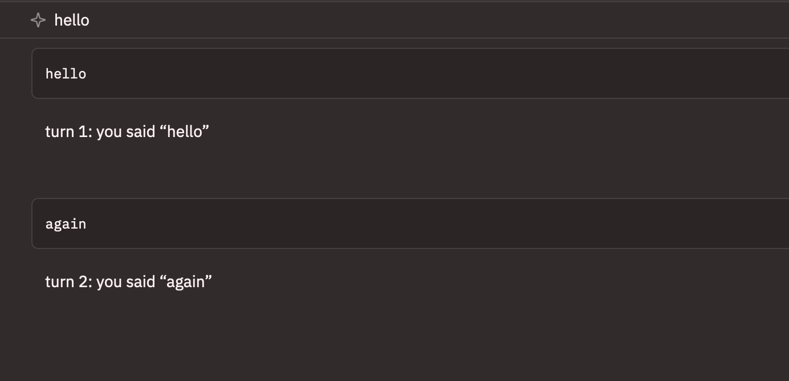

# acp-agent

A Fascicle flow as an [Agent Client Protocol](https://agentclientprotocol.com)
agent in Zed's agent panel. [main.ts](./main.ts) hands a flow to `serve_acp`
from `fascicle/acp`, and Zed launches the file, opens a session, and sends
each prompt as a turn that runs the flow.



It's keyless by default. A plain step echoes each prompt with its turn
number, which is enough to check the wiring between Zed and the agent before
you spend a token. `--model` switches it to a real model, on OpenRouter unless
`--provider` names another one. [engines.ts](./engines.ts) holds that switch
and the key each provider reads from the environment.

Stdout carries the protocol, so nothing in either file writes to it.
[docs/acp.md](../../docs/acp.md) covers the rest: where credentials come from,
what a turn carries, and how to keep a model call's text out of the reply.

## Flow

```text
echo            keyless: the prompt back, with its turn number
```

```text
sequence        with --model
├─ history      the earlier turns and the new prompt, as messages
└─ model_step   the model's answer, streamed into the reply as it arrives
```

## Run in Zed

Add a custom agent server to Zed's `settings.json` (Agent Settings, then
External Agents, then Add Custom Agent opens the same entry). Zed doesn't
launch the agent from the Fascicle repo, so tsx won't find the root
`tsconfig.json` on its own. Without its `paths`, `fascicle/acp` resolves
through the package's own exports to `dist/acp.js`, which is missing or stale
until the next build. `--tsconfig` points tsx at the source instead, and the
absolute paths keep the entry independent of the directory Zed launches it
from.

```json
{
  "agent_servers": {
    "Fascicle example": {
      "type": "custom",
      "command": "/abs/path/to/fascicle/node_modules/.bin/tsx",
      "args": [
        "--tsconfig", "/abs/path/to/fascicle/tsconfig.json",
        "/abs/path/to/fascicle/examples/acp-agent/main.ts"
      ],
      "env": {}
    }
  }
}
```

1. Open the Agent Panel, start a new thread, and pick "Fascicle example" from
   the agent selector.
2. Send a prompt. The echo should answer, and a second prompt should report
   turn 2.
3. Add `"--model", "anthropic/claude-sonnet-5.5"` to `args` and
   `OPENROUTER_API_KEY` to `env`. Replies should now stream in as they arrive.
   The same flow runs on Anthropic's own API with
   `"--provider", "anthropic", "--model", "claude-opus-5-5"` and
   `ANTHROPIC_API_KEY`, with no code change. For Bedrock, use
   `"--provider", "bedrock"` with a Bedrock model id, run `aws sso login`
   first, and set `AWS_PROFILE` and `AWS_REGION` in `env` if the defaults
   aren't the ones you want. A local Ollama needs no key at all:
   `"--provider", "ollama", "--model"` and the name of a model you've pulled.
   An instruct model suits step 4 best, because a reasoning model can think
   for a minute or more before it writes a word of its reply.
4. Press stop while a reply streams (on a model, since the echo answers at
   once). The turn should end as cancelled, and the next prompt should still
   work.
5. Run `dev: open acp logs` from the command palette and read the traffic. A
   line that isn't JSON-RPC means something wrote to stdout.

## Run directly

The agent waits for an ACP client on stdin and serves until stdin closes, so
one `initialize` request piped in is a quick check that it starts and answers
in JSON-RPC:

```bash
echo '{"jsonrpc":"2.0","id":1,"method":"initialize","params":{"protocolVersion":1}}' \
  | pnpm exec tsx examples/acp-agent/main.ts
```
