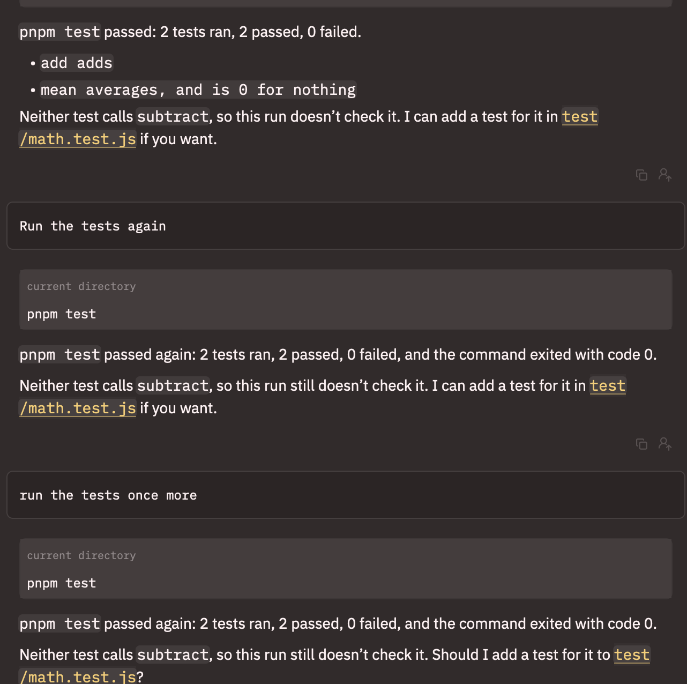

# acp-coder

A coding agent for Zed's agent panel, served over the
[Agent Client Protocol](https://agentclientprotocol.com). [main.ts](./main.ts)
gives each session one model call that holds the workspace tools from
`fascicle/acp`, so the model can read, search, and edit the files in the
folder Zed opened and run commands there. Edits and commands ask in Zed
first, as often as the session's mode says to, and
[prompts/coder.md](./prompts/coder.md) is the system prompt that tells the
model how to work.



It answers with `anthropic/claude-sonnet-5.5` on OpenRouter unless `--model`
names another model. `--provider` switches the provider through the same
switch that [acp-agent](../acp-agent/) uses, and its
[engines.ts](../acp-agent/engines.ts) lists the providers and the key that
each one reads. [docs/acp.md](../../docs/acp.md) covers what a turn carries
and where credentials come from.

## Flow

```text
sequence        built once per session, since its tools and approvals belong to it
├─ history      the earlier turns and the new prompt, as messages
└─ coder        the model with the workspace tools, up to 100 steps a turn
```

## What a command can reach

The file tools stop at the workspace. A path outside the folder Zed opened
comes back as an error that the model reads and passes on. A command is
different, because it runs through `/bin/sh` and reaches whatever you can.
That's why Manual, the mode a session starts in, asks before every command,
and why Auto belongs in a container or a throwaway worktree.

Commands inherit the agent's environment, minus the API keys that
`engines.ts` reads. `main.ts` hands `workspace_tools` that trimmed copy as
`command_env`, so a command the model runs can't read the key that the model
runs on.

## How hard it thinks

`--effort` sets how hard the model thinks before it answers. It takes `low`,
`medium`, `high`, `xhigh`, or `max`, and it's unset by default. `none` is the
same as leaving it out, since neither one sends anything to the provider.

Claude Sonnet 5.5 thinks without the flag. It decides at each step whether
the work in front of it needs thinking through, and OpenRouter sends back a
summary of what it thought. So Zed already shows a thought block on a step
that took some reasoning, and none on a step that went straight to a tool
call. `--effort high` asks it to think more often and for longer, so more
steps get a thought block and each block runs longer, while every step
spends more output tokens and starts its reply later. `--effort low` asks it
to think less.

To set it in Zed, add `"--effort", "high"` to the `args` of the entry below.

## Run in Zed

Add a custom agent server to Zed's `settings.json`, the same way as for
[acp-agent](../acp-agent/README.md#run-in-zed), with this example's `main.ts`,
a model, your OpenRouter key, and a `PATH`:

```jsonc
{
  "agent_servers": {
    "Fascicle coder": {
      "type": "custom",
      "command": "/abs/path/to/fascicle/node_modules/.bin/tsx",
      "args": [
        "--tsconfig", "/abs/path/to/fascicle/tsconfig.json",
        "/abs/path/to/fascicle/examples/acp-coder/main.ts",
        "--model", "anthropic/claude-sonnet-5.5"
      ],
      // To start each thread in a mode other than Manual, uncomment this and
      // name the mode ("accept_edits" or "auto"). Zed reads this setting, and
      // not "default_mode", for an agent like this one.
      // "default_config_options": { "mode": "accept_edits" },
      "env": {
        "OPENROUTER_API_KEY": "sk-or-...",
        "PATH": "/usr/local/bin:/usr/bin:/bin"
      }
    }
  }
}
```

`PATH` is there for the commands. Each one starts with `/bin/sh -c`, which
reads no shell profile, so a `node` or `pnpm` that nvm, fnm, volta, or asdf
puts on your terminal's path can still come back as `command not found` here.
Put the directories that `dirname "$(command -v node)"` and
`dirname "$(command -v pnpm)"` print at the front of it.

Then open a scratch repository that has a test command (a `package.json`
whose `test` script runs `node --test` is enough), start a thread with
"Fascicle coder", and work through these:

1. Ask it to explain a file. Read cards should appear, and following the
   agent should open the file.
2. Ask for a change. A permission request should show the diff. Allow it, and
   the card should keep the diff.
3. Ask it to run the tests. A permission request should show the command, and
   the card should show the output.
4. Choose "Always allow `pnpm test` this session", then ask for another test
   run. It shouldn't ask again.
5. Switch to Accept edits in the mode picker and ask for another change. It
   should edit without asking, but still ask before a command.
6. Ask it to run `sleep 60 && echo done`, allow it, and press stop. The turn
   should end as cancelled, and `pgrep -fl 'sleep 60'` should find nothing.
7. Ask it to read a file outside the project. The tool should refuse, and the
   agent should say why.
8. Swap `--model` for a model from another vendor, such as
   `google/gemini-3.8-flash`, and repeat step 2.

Two more checks round it out. Switch to Auto, ask for a change and a test
run, and neither should ask. And start a long command again, quit Zed while it
runs, and `pgrep` should find nothing left behind.

## Run directly

The agent waits for an ACP client on stdin and serves until stdin closes, so
one `initialize` request piped in is a quick check that it starts and answers
in JSON-RPC:

```bash
echo '{"jsonrpc":"2.0","id":1,"method":"initialize","params":{"protocolVersion":1}}' \
  | pnpm exec tsx --env-file=.env examples/acp-coder/main.ts
```
