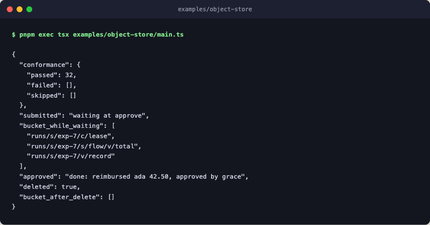

# object-store

A durable run kept in a bucket, through `object_store` from
`fascicle/adapters`. The store sits over a small client interface, and it has
the scopes, the claims, and the conditional writes that `durable` needs, so a
run that waits at a gate can live where every host in a fleet reaches it. The
client here is an in-memory fake with S3's shape. Swap in a real one and the
store works the same way
([human-in-the-loop.md](../../docs/human-in-the-loop.md#the-store-a-run-lives-in)
has one for `@aws-sdk/client-s3`).



The screenshot is from before the suite grew its compare-and-set checks. The
store passes all 47 now.

## How the Store Works

Four parts of it are easy to get wrong in a store of your own, and the
conformance suite checks each one.

- **Keys.** A scope is a key prefix, and every name is percent-encoded before
  it joins one, dots included. Values, claims, and nested scopes each sit
  under a segment of their own (`v/`, `c/`, `s/`). So two names can't reach the
  same object however alike they look, and clearing scope `a` deletes what's
  under its own prefix and never touches a scope named `a/b`. A name whose
  encoding runs past 128 characters is cut to 64 and given a hash of the whole
  name, which keeps a key under S3's 1,024-byte limit.
- **Conditional writes.** A value's version is its ETag. `set_if` creates with
  `If-None-Match: *` and replaces with `If-Match` on the version it was given,
  so when writers race, the bucket takes exactly one of their writes. A
  condition that fails is read again before it counts. An SDK that retries a
  put whose answer got lost sees its own earlier write as the conflict, so
  when the object holds the body that this call sent, the write landed.
- **Claims.** A claim is an object that holds its owner and expiry, and it
  changes hands through the same two conditions, on the ETag the claimer just
  read. A release overwrites the claim as expired rather than deleting it. A
  plain delete could erase a claim that another owner took in between, and
  not every service has a conditional delete.
- **Clear.** It lists the scope's prefix a page at a time and deletes each
  key, following the continuation the way every real listing needs.

`run_object_store()` runs `checkpoint_store_conformance` with a fresh bucket for
each check and a `corrupt` hook, so the damage checks run too, and
`test/examples.test.ts` holds it to no failures and nothing skipped. Then it
drives an expense report through `durable`:

1. The report comes in and starts the run. It totals the receipts inside a
   checkpoint and stops at the manager's approval. The bucket now holds the
   run's record, the checkpointed total, and the lease it released.
2. The approval arrives on a client and a driver of its own, the way a second
   process would bring it, and finishes the run.
3. Deleting the run clears its scope, and the bucket is empty again.

Every step is a deterministic stub: no engine layer, no network, no LLM calls.

## Flow

```text
expense        sequence: reimburse an expense report once a manager approves it
├─ checkpoint  keep the total in the bucket
│  └─ total    add up the receipts
├─ approve     suspend: wait for a manager to sign off
└─ reimburse   pay the employee back
```

## Run

```bash
pnpm exec tsx examples/object-store/main.ts
```
